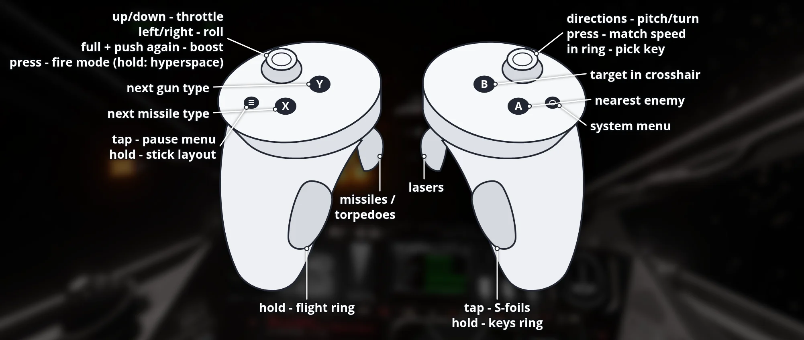

# Fate of the Galaxy VR (Meta Quest and PICO)

**Download, install guide, controls and pictures: [portroyale.online/fotg.html](https://portroyale.online/fotg.html)**

[Fate of the Galaxy](https://www.moddb.com/games/fate-of-the-galaxy), the free
Star Wars Original Trilogy total conversion, running natively on the Meta Quest 3,
built on the [FreeSpace Open](https://github.com/scp-fs2open/fs2open.github.com)
engine with OpenXR on OpenGL ES. Branch: `fotg-vr`. FreeSpace 2 is not needed.

The APK contains only the engine. The game data (free) comes from the Fate of the
Galaxy team's official Nebula release; the app's **One-Tap Installer** downloads it
on first start (2.6 GB download, 4.6 GB on the headset).

## Install

1. Install `FotG-VR-<version>.apk` with SideQuest or `adb install -r -g`.
2. Start **Fate of the Galaxy VR** from *Unknown Sources*. On the first start the
   **One-Tap Installer** opens:
   - Press *Allow file access*, switch on "Allow access", go back.
   - Press *Download and install*. It downloads the game data from FSNebula, checks
     it, packs it into a few archives (fast loading) and halves the largest ship and
     planet textures (cockpits stay full size). About 15 - 30 minutes on Wi-Fi;
     keep the headset on. If it gets interrupted, start the app again and it
     continues where it stopped.
   - When it is done, the game starts by itself.

Without Wi-Fi on the headset: on a PC with Python 3, 7-Zip and the headset on USB,
`python3 tools/quest/get_fotg_data.py --push` does the same and copies the result
to `/sdcard/FotG/FotG_R`. A plain copy of the Knossos.NET install (`FotG_R-<version>`
folder contents to `/sdcard/FotG/FotG_R`) works too, but takes 8.7 GB and loads
more slowly.

### PICO (untested)

The same APK also runs on PICO 4, PICO 4 Ultra and PICO Neo 3 (PICO OS 5.9.0 or
newer); the PICO controllers use the same button layout as the Touch controllers
below. PICO support is not tested on PICO hardware yet.

1. Install with `adb install -r -g FotG-VR-<version>.apk` (SideQuest is a Quest tool).
2. Start the game: the One-Tap Installer asks for storage access and downloads the
   game data (or use `python3 tools/quest/get_fotg_data.py --push --serial <id>`).

The rendering resolution is picked for the headset's chip: 1125 x 1125 per eye on
XR2 Gen 2 (Quest 3/3S, PICO 4 Ultra), 750 x 750 on XR2 Gen 1 (Quest 2/Pro, PICO 4,
Neo 3). Change it in Options > Detail > Game VR Resolution (restart needed). Menus,
cutscenes and the HUD are drawn on their own layers at a higher resolution, so their
text stays sharp whatever this is set to. If the
game doesn't start or the controllers do nothing,
`adb logcat -s FotGVR:* QuestVR:*` shows how far it gets.

## Controls

Menus, briefings and cutscenes are shown on a large screen in front of you.

| Input | Action |
|---|---|
| Laser (either controller) + trigger | Click |
| A | Enter |
| B / left Menu button | Escape (back / pause) |
| A, B, Menu or trigger during a cutscene | Skip it |
| X / Y | F11 / Space: fleet information and its next page (Galactic Civil War campaign) |

Text fields (pilot callsign, chat): a keyboard appears below the menu screen while the
field is active; point at a key and pull the trigger. Hold Back to keep deleting.

Flight (the Touch controllers act as one gamepad; every binding can be changed
in Options > Controls, "Reset to default" restores this layout):

| Input | Action |
|---|---|
| Left stick | Pitch and turn |
| Right stick left/right | Roll |
| Right stick up/down | Throttle (stays where you leave it) |
| Right stick click | Match target speed |
| Left stick click (tap) | Laser fire mode (single / linked) |
| Left stick click (hold 1 s) | Jump to hyperspace (end mission) |
| Right trigger | Lasers |
| Left trigger | Missiles / torpedoes |
| Right grip (tap) | S-foils open / closed |
| A | Target nearest enemy (next ship if there is no enemy) |
| B | Target ship in crosshair |
| X | Next missile type |
| Y | Next gun type |
| Left Menu button | Pause menu |
| Left grip (hold) | Flight radial menu, see below |
| Right grip (hold) | Keys radial menu (1 - 0 and more), see below |

**Radial menus:** hold a grip and a small ring of actions appears above that
controller. Point that hand's stick at an action (it lights up) and let go of the
grip to use it; let go with the stick centred to close the ring without doing
anything. While a ring is open its stick doesn't fly the ship.

Left grip, flight functions (clockwise from the top): shields to the front, next
target, target your target's attacker, next subsystem, targeting computer on/off,
nearest friendly, comms menu, shields to the rear, chase view, missile salvo,
balance power and shields, more power to engines, more power to shields, more
power to lasers.

Right grip (hold for a moment; a short tap is the S-foils): the number keys 1 - 9
and 0 (missions ask for them, e.g. "press 1" to answer), mouse mode (the first
training mission asks for it), floodlight, active pause, next turret, escort ship
and bombs / bombers.

Mission hints ("Press ...") name the controller button or ring item to use, e.g.
"Press Next target (left ring)". Training missions keep your ship in place until
you have done the targeting lessons.

Comms menu open: left stick up/down picks an order, A or a trigger confirms,
Y closes the menu.

## Building

Linux host with the Android SDK/NDK: `tools/quest/build_apk.sh --install`.
`tools/quest/run.sh` launches it on a connected headset and
`tools/quest/mission_test.sh` flies a Rebel mission and prints the frame rate.

## License

The FreeSpace Open engine is released under the Volition source code license
(non-commercial use only); see `Copying.md`. Fate of the Galaxy is a fan
project by the Fate of the Galaxy Dev Team, not associated with Lucasfilm or
Disney; its data is not included in the APK.
